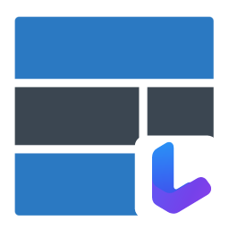

<p align="center">
  
</p>

# Lengko.DockingPanel.WinForms — Demos & Samples

Visual Studio-grade docking window manager and MDI document workspace for **Windows Forms**. Zero external dependencies, pure WinForms + GDI+ double-buffered rendering.

[]()
[]()
[]()
[](LICENSE.txt)

---

## Projects in this Folder

| Language | Project File | Description |
|---|---|---|
| **C#** | `CSharp/Lengko.DockingPanel.Demo.CSharp.csproj` | Comprehensive C# showcase featuring MDI documents, Solution Explorer, Properties grid, Output window, theme switching, tab styles, XML layout serialization, and Ctrl+Tab switcher. |
| **VB.NET** | `VB/Lengko.DockingPanel.Demo.VB.vbproj` | Full VB.NET showcase implementing multi-panel docking, theme switching, and document management. |
| **F#** | `FSharp/Lengko.DockingPanel.Demo.FSharp.fsproj` | Functional F# WinForms demo demonstrating dock content setup, workspace layout, and theme toggling. |

Dedicated solution: **`Lengko.DockingPanel.sln`** (builds all 3 demos alongside the library).

---

## Controls & Features Demonstrated

- `LengkoDockPanel`: Main docking container supporting auto-hide strips, splitters, document zones, and floating tool windows.
- `LengkoDockContent`: Dockable container hosting user controls or custom views.
- `DockState`: `Document`, `DockLeft`, `DockRight`, `DockTop`, `DockBottom`, `AutoHideLeft`, `AutoHideRight`, `AutoHideTop`, `AutoHideBottom`, `Float`, `Hidden`.
- `DockThemeMode`: Built-in themes including `Light`, `Dark`, and `Blue` (Visual Studio style).
- `DockTabStyle`: Customizable tab headers (`Rectangular`, `Rounded`, `Angled`, `Underline`).
- `DockLayoutSerializer`: Full XML workspace persistence (Save / Restore layout).
- `DockSwitcherOverlay`: Quick Ctrl+Tab document and tool switcher.

---

## Quick Start / How to Run

### Via Visual Studio
Open `Lengko.DockingPanel.sln`, select any demo project as Startup Project, and press `F5`.

### Via .NET CLI

```powershell
# Run C# Demo
dotnet run --project CSharp/Lengko.DockingPanel.Demo.CSharp.csproj

# Run VB.NET Demo
dotnet run --project VB/Lengko.DockingPanel.Demo.VB.vbproj

# Run F# Demo
dotnet run --project FSharp/Lengko.DockingPanel.Demo.FSharp.fsproj
```

---

## Code Examples

### C#
```csharp
using Lengko.DockingPanel.WinForms;

var dockPanel = new LengkoDockPanel { Dock = DockStyle.Fill, ThemeMode = DockThemeMode.Light };
this.Controls.Add(dockPanel);

// Create MDI Document
var doc = new LengkoDockContent(new TextBox { Multiline = true, Dock = DockStyle.Fill }, "Editor.cs");
doc.Show(dockPanel, DockState.Document);

// Create Tool Windows
var explorer = new LengkoDockContent(new TreeView { Dock = DockStyle.Fill }, "Solution Explorer");
explorer.Show(dockPanel, DockState.DockLeft);

var properties = new LengkoDockContent(new PropertyGrid { Dock = DockStyle.Fill }, "Properties");
properties.Show(dockPanel, DockState.DockRight);
```

### VB.NET
```vb
Imports Lengko.DockingPanel.WinForms

Dim dockPanel As New LengkoDockPanel With { .Dock = DockStyle.Fill, .ThemeMode = DockThemeMode.Light }
Me.Controls.Add(dockPanel)

' Create Document
Dim doc As New LengkoDockContent(New TextBox With { .Multiline = True, .Dock = DockStyle.Fill }, "Module1.vb")
doc.Show(dockPanel, DockState.Document)

' Create Tool Windows
Dim explorer As New LengkoDockContent(New TreeView With { .Dock = DockStyle.Fill }, "Solution Explorer")
explorer.Show(dockPanel, DockState.DockLeft)
```

### F#
```fsharp
open Lengko.DockingPanel.WinForms

let dockPanel = new LengkoDockPanel(Dock = DockStyle.Fill, ThemeMode = DockThemeMode.Light)
form.Controls.Add(dockPanel)

// Create Document
let doc = new LengkoDockContent(new TextBox(Multiline = true, Dock = DockStyle.Fill), "Program.fs")
doc.Show(dockPanel, DockState.Document)

// Create Tool Window
let explorer = new LengkoDockContent(new TreeView(Dock = DockStyle.Fill), "Solution Explorer")
explorer.Show(dockPanel, DockState.DockLeft)
```


---

## License
Proprietary Freeware License (PFL). Free for personal, educational, and commercial use. See [LICENSE.txt](LICENSE.txt).
